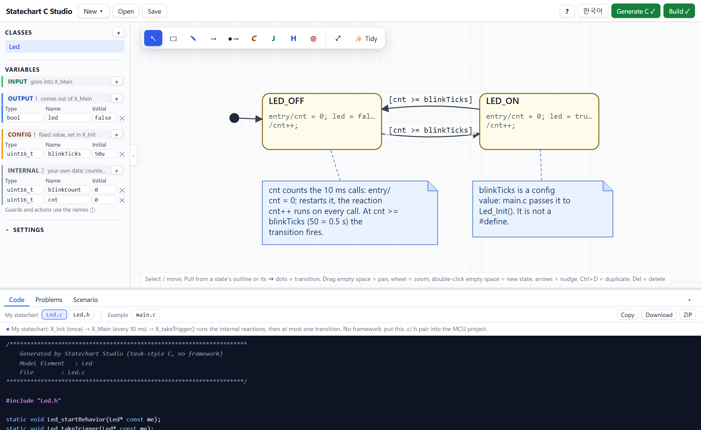
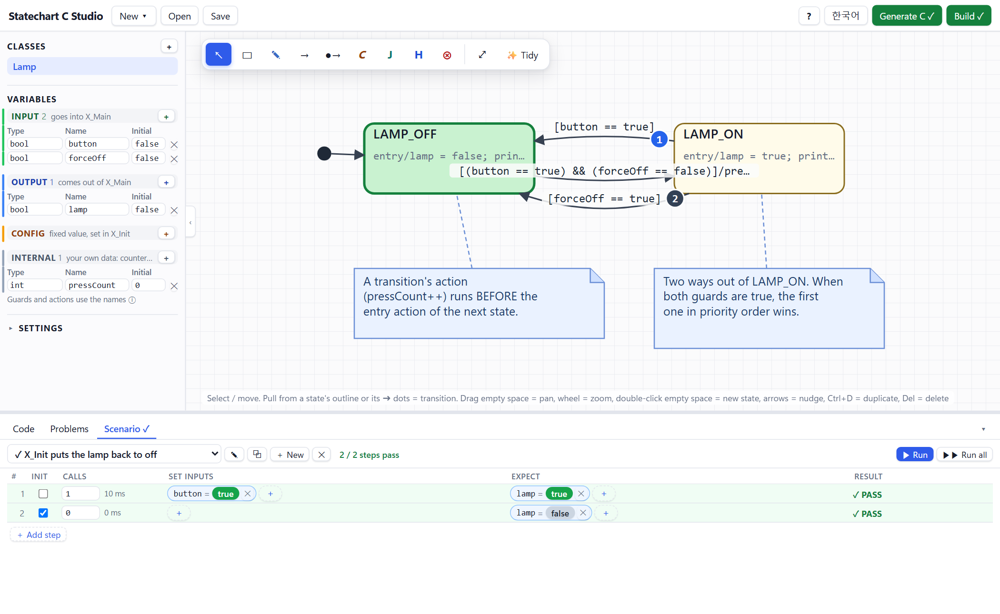
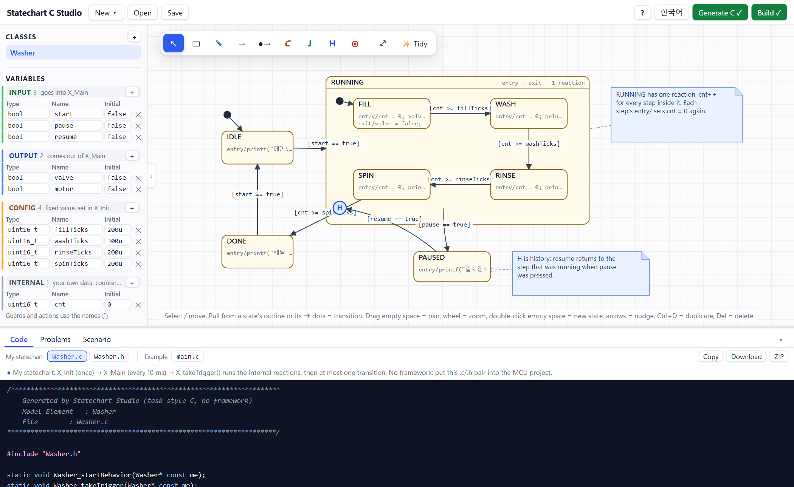

# Statechart C Studio

**Draw a statechart in your browser. Get plain C for a 10 ms task. Build it right there.**

An educational tool for people learning embedded systems.

**[Open it in your browser](https://jsyoon-git.github.io/Statechart_C_Studio/)** · [한국어 README](README.ko.md)

---



*Draw on top, read the generated C below. Green Generate C and Build mean the code is up to date and compiles.*

## Why I made this

At university I took a C programming course and an object-oriented course. Each one made sense on its own.
What nobody showed me was how they fit together in a real embedded system: how a state machine on a whiteboard
becomes the C code that runs on a microcontroller, and who calls whom, and how often.

I only understood it after I started working in industry. There, the picture is simple and very consistent:

- a periodic task (here: every 10 ms) calls each module's `Main` function,
- every module keeps its data in a struct and behaves like a state machine,
- inputs come in as parameters, outputs go out as return values,
- and time is not magic. You count it with a variable (`cnt++`, then `cnt >= 50` means 500 ms).

I wish I had seen this while I was a student. So I built the tool I would have wanted: you draw the statechart,
and it shows you the C code that comes out of it, and compiles it for you so you can see that it is real.
I hope the juniors who come after me will give it a try.

## What you can do

1. Open the page. The **LED blink** example is already there.
2. Press **Generate C** and read the code. Click a state or a transition and the matching lines light up.
3. Press **Build**. The code is compiled in your browser with a strict C89 compiler (no install, no server).
4. Change the drawing: the button turns blue again. Generate and build again until it turns green.
5. Open **New ▾** and try the next example. They go from beginner to advanced (see below).
6. Add **notes** (the ✎ tool) to explain your own drawing. **Save** keeps your work as a file on your computer.
7. Once Build is green, the **Scenario** tab unlocks: write a unit test as a table and run it against the real
   generated C (needs the local server, see below).

The generated code is two files, `X.c` and `X.h`. Copy them into an MCU project and call two functions from
the 10 ms task you already have:

```c
static Led itsLed;
static bool io_Led_led = false;

/* 10 ms task */
void Task_10ms(void) {
    io_Led_led = Led_Main(&itsLed);      /* read inputs -> run reactions -> at most one transition -> outputs */
}

int main(void) {
    Led_Init(&itsLed);                   /* once: initialise variables and enter the first state */
    for (;;) {
        Task_10ms();                     /* every 10 ms */
    }
}
```

There is no framework: no event queue, no timers, no macros. Transitions have only a **[guard]**, written in plain C.
An "event" is just an input variable that a guard reads. The generated code is C89 (ANSI C), so it builds on
old and small MCU compilers too.

## Scenarios: a unit test as a table



*A scenario is a table: set inputs, run 10 ms calls, check outputs.*


A scenario is a table. Every row is one step: optionally call `X_Init` again, set some **inputs**, run some 10 ms task
calls, then say what the **outputs** must be. Pick everything from menus (no typing of names).

- **Run** executes the selected scenario one row per press, so you decide when to go on; the row is marked
  PASS / FAIL and the active states light up on the drawing. **Run all** plays every scenario.
- A scenario only uses what the outside world sees: inputs go in, outputs come out. States and internal variables
  stay inside the chart (the drawing already shows the states).
- The scenarios run the **generated C itself** (compiled with a small test harness), not a copy of its logic.
  That needs a C compiler on your computer, so it works with the local server (`python editor/server.py`),
  not on the online page. The online page still lets you read the examples' scenarios.
- All examples come with scenarios. Renaming a variable in the drawing renames it in the scenarios too.

## Examples



*Washing machine: a composite state, a history connector and notes that explain the drawing.*


Every example has notes that explain the idea, in English and in Korean (the language button switches them).

| Level | Example | What you learn |
|---|---|---|
| Beginner | LED blink | two states, counting time with a variable, a config value |
| Beginner | Lamp with a button | inputs in guards, transition action before entry action |
| Beginner | Three-color signal | a cycle of three states, one counter shared by all |
| Intermediate | Vending machine | an input with a value, condition connector (if / else) |
| Intermediate | Washing machine | composite state, history, a counter in the parent |
| Intermediate | Button debounce | the classic MCU debounce pattern |
| Advanced | Traffic light | AND (parallel) state, history |
| Advanced | Motor control | two modules wired output to input |
| Advanced | Modem reconnect | junction, termination, retry limit |

## For teachers and students

This is meant for the classroom and for self-study. Some ways to use it:

- Start from LED blink. Ask: "What decides when it switches? Where is the time?" Then let students change `blinkTicks`.
- Have students draw their own machine (a door, a washing cycle, a vending machine), then read the C and find each state.
- Break something on purpose (a missing default transition, a wrong guard) and read the Problems tab.
- Compare two drawings of the same behaviour and discuss which code is easier to read.

## How it works

- The editor is plain HTML, CSS and JavaScript. There is no build step.
- The code generator is Python. In the browser it runs with [Pyodide](https://pyodide.org/) (Python compiled to WebAssembly),
  so the page is just static files and works on GitHub Pages.
- **Build** uses a WebAssembly build of clang ([binji/wasm-clang](https://github.com/binji/wasm-clang)) with
  `-std=c89 -pedantic -Wall -Wextra -Wdeclaration-after-statement`.
- The first visit downloads about 40 MB (Pyodide and the compiler). After that your browser keeps it.
- Your drawing is kept in your browser (local storage). Nothing is sent to a server.
- It also works on a phone: the side panel is a drawer, the code view is full screen, two fingers zoom.

To run it locally with the Python server (it can also compile with MSVC or gcc):

```bash
python editor/server.py
```

then open http://127.0.0.1:8770/. More details are in [editor/README.md](editor/README.md) (Korean).

## License

[MIT](LICENSE) © JSYoon-git. You may use, copy and change it, in class or at work. Please keep the copyright line.
The compiler and libraries under `editor/static/vendor/clang/` come from other projects and keep their own
licenses, see [THIRD_PARTY_NOTICES.md](THIRD_PARTY_NOTICES.md). This project is independent and is not affiliated
with any tool vendor.

## Tests

```bash
python editor/tests/test_codegen.py          # generated code and build checks
python editor/tests/test_edge_cases.py       # 45 awkward drawings
python editor/tests/test_sim.py              # the scenarios of every example, run against the real generated C
python editor/tests/export_parity.py         # server results, to compare with the browser version
```

`editor/tests/ui_tests.js` runs the editor's behaviour tests inside the page. `editor/tests/QA_REPORT.md` has the notes.
